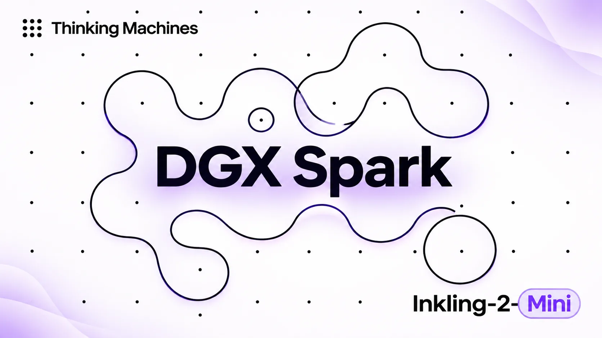

<h1 align="center">Inkling 2 Mini on one DGX Spark (TensorFold)</h1>

<p align="center">
  <sub>by <a href="https://x.com/MiaAI_lab">Mia's AI Lab</a></sub>
  <br><br>
  <a href="https://github.com/sponsors/MiaAI-Lab" target="_blank" rel="noopener noreferrer" style="display:inline-block;margin:0 8px;vertical-align:middle;"></a>
  <a href="https://x.com/MiaAI_lab" target="_blank" rel="noopener noreferrer" style="display:inline-block;margin:0 8px;vertical-align:middle;"></a>
</p>

<p align="center">
  
</p>

Serve **[Inkling 2 Mini](https://huggingface.co/thinkingmachines/Inkling-2-Mini)** on a single **NVIDIA DGX Spark** (GB10, `sm_121`, 128 GB
unified memory) through an OpenAI-compatible API (plus a `/v1/messages` Messages-format endpoint). It runs [TensorFold](https://github.com/ashhart/TensorFold)'s Zig engine
(`tensorfold-native`, Jürgen Schmied's Inkling 2 Mini CUDA engine at [PR #4441](https://github.com/ashhart/TensorFold/pull/4441), commit
`dc2ca8a1`) plus `patches/0001`–`0017` in NVIDIA's PyTorch container. It has native CUDA vision (`inkling2_vision`: PNG, JPEG, WebP) and
structured output and tool calling (`libtfgrammar.so`).

- **Model:** a looped mixture of experts.
  - 26.4B parameters in total, 3.4B active (~5.4B effective).
  - 24 physical layers; the middle 12 run 3×, so a token takes 48 visits.
  - Each layer routes a token to 8 of 128 experts.
  - Attention: 40 visits use a 1,024-token sliding window, 8 attend the whole context.
  - Vision: a 23-layer `inkling2_vision` ViT encoder (0.59 GiB bf16).
  - Checkpoint: NVIDIA ModelOpt, with NVFP4 experts (layers 0–19) and MXFP8 (20–23). Its bf16 MTP module (`mtp.safetensors`) is the DSpark
    drafter.
- **Default checkpoint:** upstream `thinkingmachines/Inkling-2-Mini`.
  - Pinned at revision `7a67ae23` and downloaded into `$HOME/models/hf/Inkling-2-Mini` by `scripts/fetch.sh`, then SHA-256 verified.
  - `RERISKED=1` serves a local [`Inkling-2-Mini-Derisked`](https://huggingface.co/Blackfrost-AI/Inkling-2-Mini-Derisked) folder instead. It is
    never downloaded automatically. It is a behaviorally modified derivative with most safety refusals removed, so treat its output as
    untrusted data.
  - Blackfrost's [deployment kit](https://huggingface.co/Blackfrost-AI/Inkling-2-Mini-Derisked/blob/main/deployment-kit/AGENT_INSTRUCTIONS.md)
    ships only for vLLM. This recipe matches it on TensorFold: vLLM's `reasoning_effort` and `reasoning` output field, the SHA-256 checks, and
    the readiness gate.
- **Default serving config:**
  - **262,144** tokens a stream (the model's limit is 1,048,576) and **8** concurrent streams.
  - `fp8` KV cache, the DSpark drafter (`DRAFTS=1`) and native CUDA vision (`VISION=1`).
  - Structured output and `tool_choice`.
  - FP8 attention projections (`TF_INKLING2_ATTN_FP8=1`) and Blackwell native FP4/MXFP8 prefill tensor cores (`TF_INKLING2_PREFILL_TC=1`).
- **One command:** `./start.sh` downloads the weights, builds the `sm_121` image on the first run and starts the server; `./stop.sh` stops it.

## Performance

Measured with [sparkDash](https://github.com/MiaAI-Lab/sparkDash/) on one **NVIDIA DGX Spark** (GB10, `sm_121`). Settings: `Inkling-2-Mini`,
`CONTEXT=262144`, `PARALLEL=8`, `KV_DTYPE=fp8`, `DRAFTS=1` (DSpark), `TF_INKLING2_ATTN_FP8=1`, `TF_INKLING2_PREFILL_TC=1`.

### Prefill

| Context | tok/s | TTFT | Prompt tokens |
| --- | ---: | ---: | ---: |
| 4k | **3,497.1 tok/s** | 1.34 s | 4,131 |
| 8k | **3,343.6 tok/s** | 2.62 s | 8,224 |
| 16k | **3,252.5 tok/s** | 5.21 s | 16,415 |
| 32k | **3,072.2 tok/s** | 10.84 s | 32,802 |
| 64k | **2,749.6 tok/s** | 24.01 s | 65,573 |
| 128k | **2,267.3 tok/s** | 57.99 s | 131,106 |

### Decode (`temp 0.7` · thinking on · `top_k 20` · DSpark drafts)

| Streams | Prose agg | Prose / stream | Prose TTFT | Code agg | Code / stream | Code TTFT |
| --- | ---: | ---: | ---: | ---: | ---: | ---: |
| ×1 | **48.3 tok/s** | 48.3 tok/s | 71 ms | **56.1 tok/s** | 56.1 tok/s | 183 ms |
| ×2 | **74.9 tok/s** | 37.6 tok/s | 312 ms | **86.5 tok/s** | 46.5 tok/s | 216 ms |
| ×4 | **106.1 tok/s** | 27.9 tok/s | 366 ms | **108.5 tok/s** | 31.6 tok/s | 407 ms |
| ×8 | **145.0 tok/s** | 20.1 tok/s | 697 ms | **149.4 tok/s** | 24.6 tok/s | 755 ms |

## Checks

All of these passed with the defaults (`CONTEXT=262144`, `PARALLEL=8`, `KV_DTYPE=fp8`, `DRAFTS=1`, `VISION=1`), patches 0001–0017:

- **`tools/exact.py`** (pads 0, 3k and 24k): **PASS**. Every prompt matches across serial drafted, `"draft": false` and 6-way concurrent replies
  (494–503 drafts accepted).
- **`tools/prompt_reuse.py`** (30k, 4 follow-up turns, another conversation in between): **PASS**. Each follow-up reused 99.4%–99.5% of its prompt
  from the cache, with a 0.22 s warm prefill.
- **200k-token needle in a haystack** (199,951 prompt tokens, `max_tokens=512`): **PASS** at 10%, 50% and 90% depth (`warm-library-4557`; ~106 s
  cold prefill).
- **Structured output and `tool_choice`**: **PASS**, 10/10, with valid JSON and tool calls across greedy and sampled draws, and no HTTP 500s.
  Covers `json_schema`, `json_object`, `guided_regex`, `guided_choice`, `required` and a named function.
- **Vision**: **PASS**, 17/17.
  - PNG: solid colour, RGBA alpha, two images in order, and a 3000×2000 image (downscaled).
  - JPEG: text, shapes and EXIF orientation. WebP: text.
  - Images with `json_schema` and with `tool_choice: "required"`.
  - Streamed replies equal whole ones, drafted equal `"draft": false`, 4 requests at once.
  - A corrupt image returns HTTP 400.
- **Lossy defaults, task accuracy:** a 734-problem set covers arithmetic, word problems, code tracing, logic, record lookups at 8k–120k tokens
  and two-record sums. It scored **732/734** with `TF_INKLING2_PREFILL_TC=1` and with `0`. Teacher-forced top-1 agreement of the tensor-core
  prefill with the exact path is 96.3%.

## Requirements

- An **NVIDIA DGX Spark** (or another GB10 system with 128 GB of unified memory, aarch64), with nothing else large in memory.
  - Loading takes about 25 GiB, and each stream holds its whole window from the start.
  - `start.sh` stops before launching when `MemAvailable` is below what the settings need (`MEM_NEED_GIB`; `MEM_CHECK=0` starts anyway).
- Docker with the NVIDIA Container Toolkit, and your user in the `docker` group.
- ~40 GB free under Docker's root for the image, plus ~20 GB for the checkpoint.

## Quick start

```bash
git clone https://github.com/MiaAI-Lab/Inkling-2-Mini-DGX-Spark-TensorFold.git
cd Inkling-2-Mini-DGX-Spark-TensorFold
./start.sh
```

On the first run, `./start.sh` does five things:
1. Downloads `thinkingmachines/Inkling-2-Mini` (~18.8 GB, resumable).
2. Builds `tensorfold-inkling2:c4-dc2ca8a`, with the kernels embedded in the binary for `sm_121`.
3. Verifies the checkpoint's SHA-256 once.
4. Launches the server on port `8888`.
5. Runs a smoke test.

Override settings with environment variables or a `.env` file next to `start.sh`.

```bash
curl -s http://<spark-address>:8888/v1/models

curl -s http://<spark-address>:8888/v1/chat/completions -H 'Content-Type: application/json' -d '{
  "model": "Inkling-2-Mini",
  "messages": [{"role": "user", "content": "Write a Python fibonacci function."}],
  "max_tokens": 2000
}'
```

```bash
./start.sh restart                  # restart (validates args before stopping)
RERISKED=1 ./start.sh restart       # serve the local Inkling-2-Mini-Derisked folder
PARALLEL=4 ./start.sh restart       # fewer streams, more prompt cache
./stop.sh                           # stop the container
docker logs -f inkling2-mini-tf     # follow server logs
curl -s http://<spark-address>:8888/health
```

- `FOREGROUND=1 ./start.sh` stays attached.
- `DRY_RUN=1 ./start.sh` prints the `docker run` command without changing anything.
- Extra arguments pass straight to `tensorfold-native serve` (`./start.sh restart --context 131072`).

## KV cache & memory budget

On a 128 GB DGX Spark with the defaults (`CONTEXT=262144`, `PARALLEL=8`, `KV_DTYPE=fp8`, `DRAFTS=1`, `VISION=1`,
`TENSORFOLD_MEMORY_RESERVE_GIB=9`):

- **Weights:** ~19.7 GiB (`17.60 GiB` target + `1.54 GiB` DSpark + `0.59 GiB` vision), plus scratch.
- **Active KV slots:** **44.5 GiB** (`5.56 GiB` a stream × 8 streams = **2,097,152 active tokens**; `fp8` target KV, `bf16` DSpark KV).
- **Prompt cache pool:** whatever is left after a `9.0 GiB` reserve. That's **16.0 GiB** on an otherwise idle Spark, less when other
  containers share the memory.
- **Engine total:** ~59.7 GiB plus the prompt cache.

Every stream reserves its full `CONTEXT` window at startup. For exact serving:
- `KV_DTYPE=bf16` (with, say, `PARALLEL=4`) for bf16 KV caches;
- `TF_INKLING2_ATTN_FP8=0` for bf16 attention projections;
- `TF_INKLING2_PREFILL_TC=0` for bf16 prefill experts.

## Configuration

All defaults live in [`scripts/config.sh`](scripts/config.sh). Override them from the environment (`PARALLEL=4 ./start.sh restart`) or from
`.env` (the environment wins):

| Variable | Default | Meaning |
| --- | --- | --- |
| `RERISKED` | `0` | `0`: upstream `Inkling-2-Mini` (auto-fetched); `1`: local `Inkling-2-Mini-Derisked` |
| `MODEL_DIR` | `$HOME/models/hf/Inkling-2-Mini` | checkpoint folder, mounted read-only at `/models/ink` |
| `PARALLEL` | `8` | concurrent request slots (each gets a full `CONTEXT` window) |
| `CONTEXT` | `262144` | prompt + reply window a stream (up to `1048576`) |
| `KV_DTYPE` | `fp8` | target KV cache: `fp8` or `bf16` (exact) |
| `DRAFTS` | `1` | `1`: DSpark drafter (`--drafter /models/ink`); `0`: `--no-drafts` |
| `VISION` | `1` | `1`: Inkling 2 vision tower (`--vision`, ~0.59 GiB, PNG/JPEG/WebP); `0`: text only |
| `VISION_URLS` | `0` | `1`: also fetch http(s) image URLs (`--vision-urls`); `data:` URLs always work |
| `VISION_MAX_IMAGES` / `VISION_IMAGE_TOKENS` | unset | images a request (engine default 4, up to 100) and an image's token budget (default 4,096) |
| `THINKING` / `REASONING_EFFORT` | `1` / unset | thinking toggle and an optional default effort (`none`, `minimal`, `low`, `medium`, `high`, `xhigh`, `max`, or `0`–`0.99`) |
| `TEMPERATURE` / `TOP_P` / `TOP_K` | `1.0` / `1.0` / `0` | default sampling (a request's own values win) |
| `MAX_TOKENS` | `32768` | reply budget when a request sets none |
| `PORT` / `HOST` | `8888` / `0.0.0.0` | API listen address |
| `TENSORFOLD_MEMORY_RESERVE_GIB` | `9` | memory kept free when sizing the KV and prompt-cache pool |
| `TF_INKLING2_ATTN_FP8` | `1` | FP8 attention projections (`0` for exact bf16) |
| `TF_INKLING2_PREFILL_TC` | `1` | Blackwell native FP4/MXFP8 prefill tensor cores (`0` for exact bf16 MMA) |
| `NATIVE_FP_DECODE` | `1` | build with `-Dnative-fp-decode` (sm_121a's native FP4/FP8 decode in the expert kernels; exact) |

### API notes

- **Endpoints:** `/v1/chat/completions`, `/v1/completions`, `/v1/responses`, `/v1/messages` (Messages format), `/v1/models`, `/tokenize`,
  `/detokenize`, `/health`, `/metrics`.
- **Vision:** on by default (`VISION=1`, `--vision`). It takes PNG, JPEG and WebP `image_url` data URLs: 4 images a request by default, up to
  100 with `VISION_MAX_IMAGES`. `VISION_URLS=1` also allows http(s) image URLs. An image that can't be decoded is an HTTP 400.
- **Structured output & tool calling:** `response_format` (`json_schema`, `json_object`), `guided_regex`, `guided_choice`, and `tool_choice`
  (`auto`, `required` or a named function). `TF_TOOL_CALL_GUARD=1` hides well-formed calls to tools the request did not offer, and
  `TF_TOOL_CALL_DEBUG=1` logs rejected envelopes.
- **Dashboard:** pass `--dashboard`. With `TENSORFOLD_API_KEY` set, add `--dashboard-open` so a browser can open `/dashboard` and `/stats`
  without the key.
- **Thinking:** the model reasons before answering even at `reasoning_effort: "none"`, so give replies enough `max_tokens`. Per request,
  `"chat_template_kwargs": {"reasoning_effort": "low"}` adjusts it.
- **Exact serial reference:** `"draft": false` on any request turns drafting off. Drafted replies match `"draft": false` token for token.
- **Admission:** when all `PARALLEL` slots are full, new requests are rejected rather than queued.

## Patches (`patches/0001`–`0017`)

Applied in order onto TensorFold `dc2ca8a1` (PR #4441) by `scripts/prepare.sh`:

| Patches | Summary |
| --- | --- |
| `0001`–`0004` | Drafted verify windows with exact conv rollback and taps; the CUDA DSpark drafter (`mtp.safetensors`); `--kv-cache fp8`; the Inkling 2 reply, reasoning and tool parser (PR #4124) |
| `0005`–`0009` | Kernel speedups, all exact: tiled loop mix, batched DSpark holds, FP8 draft head and layers, a 2-warp NVFP4 expert split, a certified lazy unembedding head, warp top-k, fused sliding prompt attention and multi-row projections |
| `0010`–`0012` | vLLM-compatible `reasoning_effort` and `reasoning` field; bf16 decode attention prefetch (`cp.async`); opt-in FP8 attention projections (`TF_INKLING2_ATTN_FP8=1`) |
| `0013` | Structured output (`response_format`, `guided_*`) and `tool_choice` (`required`, a named function) on CUDA: grammar-masked greedy and sampled draws, vLLM-parity Inkling framing and tool-choice prompts, and `libtfgrammar.so` built from the patched tree with xgrammar v0.2.8's compile cache off |
| `0014` | Exact speedups: 4,096-row prompt passes and a 64-entry CUDA graph cache (`wide_graphs`) for drafted and multi-row verify rounds (`TF_INKLING2_WIDE_GRAPHS=0` for the old path) |
| `0015` | Blackwell native block-scaled tensor-core prefill experts (`sm_121a`, `TF_INKLING2_PREFILL_TC=1`): prompt activations quantized once a layer (38 MiB of scratch), then `kind::mxf4nvf4` (layers 0–19) and `kind::mxf8f6f4` (20–23) run directly over TensorFold's packed weights |
| `0016` | Native CUDA vision encoder (`inkling2_vision`): `Inkling2ImageProcessor` (PNG/JPEG/WebP, EXIF orientation, 8×8 checkerboard alpha, `-1.0` padding to 40×40 tiles), the 23-layer ViT with 2D pairwise axial RoPE, LayerScale and bilinear position embeddings, `vision_kernel<64, 8>` tensor-core attention, the 2×2 spatial merge and GELU projector, and image embeddings spliced into the prompt (`--vision`) |
| `0017` | Server fixes: the reply grammar is freed when a stream fails to start (`lane_stream.zig`); opt-in `TF_TOOL_CALL_GUARD=1` and rejected tool-envelope logs (`TF_TOOL_CALL_DEBUG=1`); `--vision-max-images` up to 100; `--dashboard-open` |

## Tools

`tools/` talks to the running server (`API_URL`, default `http://127.0.0.1:8888`, or `PORT`):

| Script | What it checks |
| --- | --- |
| `tools/exact.py` | greedy replies: drafted, `"draft": false` and concurrent must match token for token |
| `tools/prompt_reuse.py` | multi-turn prompt cache reuse |
| `tools/needle.py` | passphrase retrieval in a ~200k-token haystack |
| `tools/bench_streams.py` | decode at 1 to N concurrent requests and prefill 4k to 128k |
| `tools/client.py` | CLI chat client and shared helpers |

## Repository layout

```
start.sh      set up (first run) and start the server
stop.sh       stop it
scripts/      config.sh, prepare.sh, fetch.sh, banner.sh
patches/      0001–0017 applied onto TensorFold at TF_REF
tools/        verification scripts
CREDITS.md    upstream credits
NOTICE        third-party notices
```

## License

Apache-2.0, see [`LICENSE`](LICENSE). Model weights are not part of this repository: `thinkingmachines/Inkling-2-Mini` is Apache-2.0 with Thinking
Machines' [Model Acceptable Use Policy](https://thinkingmachines.ai/model-acceptable-use-policy/), and `Inkling-2-Mini-Derisked` is subject to
the upstream terms and notices.

**Third-party software in the image.** The image `scripts/prepare.sh` builds is based on NVIDIA's PyTorch container
(`nvcr.io/nvidia/pytorch:26.07-py3`). The NVIDIA software in it is governed by the
[NVIDIA Software License Agreement](https://www.nvidia.com/en-us/agreements/enterprise-software/nvidia-software-license-agreement/) and the
[Product-Specific Terms for NVIDIA AI Products](https://www.nvidia.com/en-us/agreements/enterprise-software/product-specific-terms-for-ai-products/).
By running the image you accept them. The Apache-2.0 license covers this repository's scripts and patches only. The image also carries the licenses of xgrammar,
libjpeg-turbo and libwebp, which it builds.

## Credits

- **Recipe & patches (`0001`–`0003`, `0005`–`0017`):** created and built by **[MiaAI-Lab](https://github.com/MiaAI-Lab)** (Mia's AI Lab). That
  includes:
  - CUDA DSpark drafting, `--kv-cache fp8`, and decode and prefill kernel optimizations;
  - 4,096-row passes, wide verify CUDA graphs, and Blackwell native FP4/MXFP8 prefill tensor cores;
  - structured output and `tool_choice`, and native CUDA `inkling2_vision` image support;
  - full TensorFold serving support for `Inkling-2-Mini-Derisked`, whose upstream
    [deployment kit](https://huggingface.co/Blackfrost-AI/Inkling-2-Mini-Derisked/blob/main/deployment-kit/AGENT_INSTRUCTIONS.md) only targets
    vLLM.

  Benchmarked with [sparkDash](https://github.com/MiaAI-Lab/sparkDash/).
- **Engine:** [TensorFold](https://github.com/ashhart/TensorFold) and `tensorfold-native` by Ash Hart ([ashhart](https://github.com/ashhart))
  and contributors.
- **Inkling 2 Mini on CUDA:**
  - Jürgen Schmied ([jschmied](https://github.com/jschmied), [PR #4441](https://github.com/ashhart/TensorFold/pull/4441),
    [#4640](https://github.com/ashhart/TensorFold/pull/4640));
  - [ajensenwaud](https://github.com/ajensenwaud): the Inkling 2 kernels and the reply parser, patch `0004` (#4124–#4128);
  - [BlivionIaG](https://github.com/BlivionIaG), [sethforprivacy](https://github.com/sethforprivacy), [gilby](https://github.com/gilby) and
    [akol1](https://github.com/akol1).
- **Blackwell prefill & chunking ideas:** [Basalt](https://github.com/jesdga95/basalt) by [jesdga95](https://github.com/jesdga95).
- **Reply-grammar leak fix (`0017`):** SvangenStudios' PR #28.
- **Model & derivative:** [Inkling 2 Mini](https://huggingface.co/thinkingmachines/Inkling-2-Mini) by Thinking Machines;
  `Inkling-2-Mini-Derisked` by Blackfrost.
- **Runtime dependencies:** [xgrammar](https://github.com/mlc-ai/xgrammar) (`libtfgrammar.so`, Apache-2.0),
  [libjpeg-turbo](https://libjpeg-turbo.org) and [libwebp](https://chromium.googlesource.com/webm/libwebp) (BSD-3-Clause),
  [Zig](https://ziglang.org), and NVIDIA CUDA.

Full list in [`CREDITS.md`](CREDITS.md).
